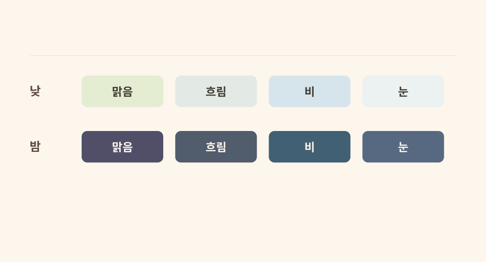
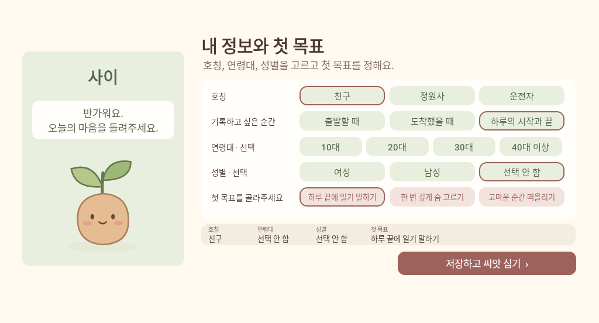
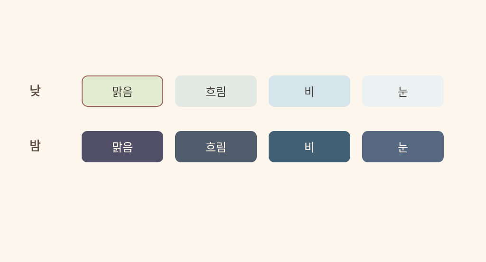

# 사이 · Hyundai Sai

출근과 퇴근 **사이**, 오늘의 마음을 씨앗으로 심고 꽃으로 남기는 차량용 감정 일기 앱.

> **0.1.0 / Figma 01행 구현 체크포인트. 전체 앱 완성본이 아닙니다.**
> 첫 실행 정보 입력 → 씨앗 심기 → 낮·밤 날씨 선택까지 작성했습니다.
> 날씨 선택 후 홈 이동은 02·05행 구현 시 연결합니다.
> 음성 일기, 감정 AI, 차량 상태 및 날씨 API는 아직 연결하지 않았습니다.

## Android Studio 실행

1. 저장소를 클론하고 **최상위 폴더**를 Open합니다 (`settings.gradle.kts`가 있는 폴더).
2. Gradle JDK **17**, SDK Platform **35**, Build Tools **35.0.0**을 설치/선택합니다.
3. Gradle Sync 후 실행 구성 `app`, 대상 기기 `Pleos Connect`를 선택하고 Run을 누릅니다.
4. 정보를 선택하고 `저장하고 씨앗 심기` → 저장 동의 → `씨앗 심기`를 누릅니다.
5. 낮/밤의 맑음·흐림·비·눈을 선택합니다. 선택은 재실행 후 유지됩니다.
6. Android 뒤로가기로 정보 수정·씨앗 화면·전체 정보 삭제·종료 메뉴를 엽니다.

이미 클론한 경우 저장소 폴더에서:

```powershell
git switch main
git pull --ff-only origin main
.\gradlew.bat assembleDebug
```

macOS/Linux: `./gradlew assembleDebug`.
APK: `app/build/outputs/apk/debug/app-debug.apk`.
`local.properties`는 Android Studio가 자신의 SDK 경로로 생성하며 Git에 올리지 않습니다.

## Pleos Connect 에뮬레이터

기존 Pleos 에뮬레이터가 있다면 그대로 선택합니다. 새로 설치할 때 SDK Manager → SDK Update Sites에
아래 주소를 추가하고 API 34 Pleos 시스템 이미지를 설치합니다.

- Windows/Linux: `https://nexus-playground.pleos.ai/repository/raw-releases/connect-avd/2.x/crp-sys-img.xml`
- macOS: `https://nexus-playground.pleos.ai/repository/raw-releases/connect-avd/2.x/crp-arm64-sys-img.xml`
- Device Manager에서 Automotive / Pleos Connect 장치 생성. 공식 가이드의 RAM 4 GB, Cold boot 설정 참고.

현재는 **Pleos에서 실행할 Android 화면·로컬 저장 기반**입니다. 전용 SDK 호출이나 실차 검증 완료를
의미하지 않습니다. Vehicle SDK 연동은 04행 범위입니다. 일반 API 28 이상 기기에서도 화면을 확인할 수 있습니다.

## 구현한 기능

| 기능 | 동작 |
|---|---|
| 내 정보 | 호칭 3종, 기록할 순간 3종, 선택 연령대·성별 |
| 첫 목표 | 일기 말하기 / 숨 고르기 / 고마운 순간 |
| 실시간 요약 | 하단 요약에 선택 즉시 반영 |
| 로컬 저장 | 동의 후 저장, 재실행 복원 |
| 선택 해제 | 연령대 재선택으로 해제, 성별 선택 안 함 |
| 씨앗 | Figma 원본 이미지 사용, 날짜별 심기 상태 저장 |
| 날씨 선택 | 낮·밤 × 4개 날씨 저장. 실제 날씨가 아닌 시연 설정 |
| 정보 관리 | 수정 및 재확인 후 전체 로컬 정보 삭제 |
| 화면 | Kotlin Native Views, 가로형 1024×552 비율 유지 |

프로필은 서버로 전송하지 않습니다. 이 단계는 인터넷/마이크/위치 권한을 요청하지 않으며,
음성이나 일기 데이터를 생성하지 않습니다. 선택 항목에는 상태를 알 수 있는 테두리를 추가했습니다.

## 디자인 및 진행표

[Figma 프로토타입](https://www.figma.com/design/V6DJBZOInaNymTAp1dgc66/?node-id=392-179)
및 제공된 기획 ZIP을 확인했습니다. 최신 Figma의 가로 줄 순서로 구현합니다.

| 행 | 범위 | 상태 |
|---|---|---|
| 01 | 정보 입력 → 씨앗 → 날씨 선택 | 구현 · APK 빌드 · Android 기능 테스트 통과 |
| 02 | 아침 홈 · 날씨 4종 | 미구현 |
| 03 | 목표 설정 · 아침 대화 · 목표 완료 | 미구현 |
| 04 | 주행 · 음성 반응 · 바람 반응 | 미구현 |
| 05 | 저녁 홈 · 날씨 4종 | 미구현 |
| 06 | 월별 일기장 · 날짜 선택 · 펼친 일기 | 미구현 |
| 07 | 날짜별 일기장 이어보기 | 미구현 |
| 08 | 연도 선택 · 빈 기록 | 미구현 |
| 09 | 마이페이지 · 리캡 · 정원 · 꽃도감 · 스트릭 | 미구현 |
| 10 | 월간 감정 요약 | 미구현 |

AI, STT/TTS, Vehicle/FusedLocation/NaviHelper, 일기 CRUD·통계는 후속 단계입니다.
외부 AI 비밀키는 앱에 넣지 않습니다. 시연 결과와 실제 분석 결과를 구분해야 합니다.

### Figma 기준 시안 (앱 실행 캡처 아님)




### 실제 Android 실행 화면 (API 34, 1024×552)





## 검증

- `./gradlew assembleDebug lintDebug`: 빌드·정적 검사.
- `./gradlew connectedDebugAndroidTest`: 기기/에뮬레이터에서 복원, 해제, 저장/삭제, 씨앗→날씨 흐름 검사.
- GitHub Actions **전체 성공**. APK·테스트 보고서·실행 캡처 생성 확인.
- lintDebug 오류 0개, 경고 7개(대상 API, 의존성 업데이트 안내, 시스템 UI API, 백업 규칙 및 앱 아이콘 관련).
- 로컬에서는 Java 네트워크 제약이 있었으나, GitHub Actions에서 **APK 빌드 및 lintDebug 검사가 통과**했습니다.
- [검증 실행 기록](https://github.com/BBIYACK-0834/Hyundai_Sai/actions/runs/43589657773)의 `sai-row01-debug-apk`에서 APK를 받을 수 있습니다.
- Android 14(API 34) 에뮬레이터 계측 테스트 **5개 통과**: 선택 복원, 선택 해제, 저장/삭제, 씨앗→날씨 전환, 3화면 캡처.
- **Pleos 전용 에뮬레이터·실차 검증은 아직 완료하지 않았습니다.**

## 구조

- `app/src/main/java/kr/co/sai/diary/MainActivity.kt`: 화면·이벤트
- `ProfileStore.kt`: 프로필·씨앗·시연 날씨 저장
- `DesignSurface.kt`: 차량 화면 비율 대응
- `app/src/androidTest/`: 상태/흐름 테스트
- `docs/PROGRESS.md`: 이어갈 위치

## 개발환경 / 공식 자료

Kotlin 2.1.20 / AGP 8.9.2 / Gradle 8.11.1 / JDK 17.
minSdk 28 / compileSdk 35 / targetSdk 34.

- [공모전 개발 환경](https://appdevchallenge.auto-hmg.io/guide/development)
- [Pleos 앱 개발 시작](https://document.pleos.ai/docs/pleos-only/getting-started)
- [AGP 8.9 호환 버전](https://developer.android.com/build/releases/agp-8-9-0-release-notes)
